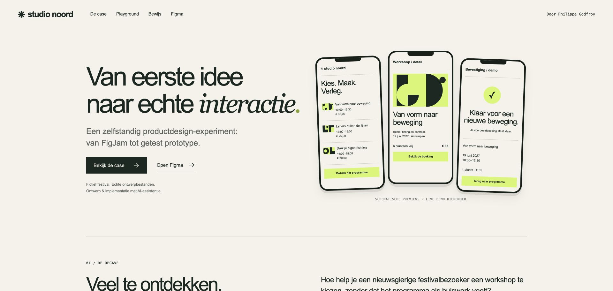

# Studio Noord — van idee naar interactie

**Een zelfstandige productdesign-case van Philippe Godfroy, met AI-assistentie.** Een fictief creatief festival als oefenterrein voor productkeuzes, een samenhangend designsysteem en een boekingsflow die je kunt testen.

[Open de portfolio-site](https://phlppgdfry.github.io/studio-noord-design-case-study/) · [Start de 2-minutentour](https://phlppgdfry.github.io/studio-noord-design-case-study/?tour#playground) · [Open Figma](https://www.figma.com/design/TvSQScyVugajxezjknx1ff) · [Native klikprototype](https://www.figma.com/proto/TvSQScyVugajxezjknx1ff?node-id=1-293&page-id=1%3A234&starting-point-node-id=1%3A293)

[](https://phlppgdfry.github.io/studio-noord-design-case-study/)

## De vraag

Hoe help je een nieuwsgierige festivalbezoeker een workshop te kiezen, zonder dat het programma als huiswerk voelt? De case verbindt de route van idee naar keuze, boeking en bevestiging. Het festival, de bezoekers en de workshopgegevens zijn fictief. De ervaring is geen echte ticketdienst.

## Kijk in twee minuten

1. **Probeer de boekingsflow.** Zoek of filter een workshop, test Volzet, open de boeking en probeer de validatie. Gebruik de knop voor fictieve demogegevens. Een bevestiging verlaagt alleen de lokale demovoorraad.
2. **Verander het systeem.** Wissel Light/Dark, informatiedichtheid en posterpalet. Pauzeer of scrub de animatie. Download de poster als SVG en de tokens als JSON.
3. **Onderzoek de keuzes.** Vier beslissingen beschrijven reden, keuze en afweging. Het bewijsregister verwijst naar de bijbehorende native bron of code.
4. **Open de overdracht.** Lees [acceptatie & toegankelijkheid](case-study/accessibility.md), [onderzoeksplan](case-study/research-plan.md) en [technische overdracht](case-study/handoff.md).

## De vier Figma-producten

| Product | Native artefact | Wat is gecontroleerd |
|---|---|---|
| **[Design](https://www.figma.com/design/TvSQScyVugajxezjknx1ff)** | Design Lab, appschermen, klikprototype | 8 componentvarianten, 7 kleurvariabelen, Light/Dark-demoframes en Auto Layout. Op pagina 02: lijst → boeking → bevestiging → lijst. |
| **[FigJam](https://www.figma.com/board/wyq7X0mYl5JVh9CGuoW4V3)** | Workshop & klantreis | 6 gebieden, brainstorm, impact/inspanning, timer en afgeronde oefenstemming met 3 demostemmen. |
| **[Slides](https://www.figma.com/slides/tZ9ynsDG41cgBAsAAk4Bjd)** | Eigen portfolio-pitch | 6 native casedia’s met ontwerpvraag, productroute, boekingsflow, afwegingen en vervolgstappen. Ook bewerkbaar op Design-pagina 04. |
| **[Make](https://www.figma.com/make/eiLRRJj6QYU0HNREZYZkLz?fullscreen=1)** | Oorspronkelijke showcase | 8 hoofdstukken; boekingsflow, kleurmodi, posterpaletten, timeline, mini-board en pitch. |

Apart oefenbestand: [Feature Tour met live poll](https://www.figma.com/slides/Nft4EWn5MTqEshKBHda0ul), met eigen PG-cover, een geteste publieksvraag met vier keuzes en 59 Figma Community-tutorialslides.

**Binnen Design:** [Draw Brush Lab](https://www.figma.com/design/TvSQScyVugajxezjknx1ff?node-id=1-600) met 2 Heist- en 2 Shoegaze-streken; [Motion](https://www.figma.com/design/TvSQScyVugajxezjknx1ff?node-id=3-6759&timeline=keyframe) met 4 seconden, 5 vormlagen, 7 tracks en 21 native keyframes. Native bewijs is handmatig gecontroleerd op 25 oktober 2026. Figma-links behouden de bestaande toegangsrechten en kunnen om login vragen.

## Wat de upgrade toevoegt

- Een zelfstandig toegankelijk webportfolio met case, beslissingen, bronverwijzingen en compacte rondleiding.
- Een lokale boekingsflow met foutmeldingen, capaciteitscontrole, bedragen in gehele centen en bescherming tegen een herhaalde bevestiging binnen dezelfde aanvraag.
- Expliciete states: geselecteerd, favoriet, leeg zoekresultaat, volzet, foutief formulier en bevestigd.
- Een webdesignlab met tokens/modes, SVG-export, bestuurbare animatie, mini-board, zes eigen casedia’s en kopieerbare prompts.
- Een [bewijsregister](docs/data.mjs), [beslissingslog](case-study/decisions.md), [onderzoeksplan](case-study/research-plan.md), [overdracht](case-study/handoff.md), uitvoerbare tests en CI.

Deze website is **een eigen implementatie op basis van het Figma-concept**, geen automatische export van het Make-project. Native Figma-artefacten en websimulaties zijn afzonderlijk gelabeld. Er is geen backend, betaalprovider, analytics of live AI-aanroep.

## Reproduceer lokaal

Node.js 20+ voor checks/tests; Python 3 voor de lokale server. Er zijn geen npm-afhankelijkheden.

```sh
git clone https://github.com/phlppgdfry/studio-noord-design-case-study.git
cd studio-noord-design-case-study
npm run check
npm test
npm start
# Open http://127.0.0.1:4178
```

Publicatie: GitHub Pages vanuit `main:/docs`. De site gebruikt relatieve paden en ES-modules; open hem via HTTP, niet door `index.html` dubbel te klikken.

```text
docs/                 gepubliceerde site, interacties en boekingsmodel
docs/assets/          handmatige tokens en eigen favicon
case-study/           brief, keuzes, onderzoek, toegankelijkheid, overdracht, validatie
design/               visueel concept en implementatie-afwegingen
tests/                uitvoerbare grensgevallen voor de boekingsregels
scripts/check.mjs     bron-, asset- en bewijscontractcontrole
.github/workflows/    CI voor checks en tests
```

## Grenzen en volgende stap

Geen interviews, usabilitysessies of conversie-experimenten zijn uitgevoerd. Het [onderzoeksplan](case-study/research-plan.md) is een voorstel. Native overlays en Smart Animate zijn nog geen onderdeel van de geverifieerde case. De native prototypeflow gebruikt schermbrede klikacties; alleen de webflow heeft echte invoervelden en voorraadlogica. De demo-voorraad is per tabblad en biedt geen transactieve multi-user reserveringen. Het live mini-board deelt geen gegevens tussen bezoekers.

Dit werk is bedoeld om product- en ontwerpafwegingen zichtbaar te maken, zonder een functietitel, klantopdracht of businessresultaat te suggereren.

## Credits & licentie

Concept, selectie, uitvoering en review: Philippe Godfroy met AI-assistentie (Codex en Figma AI/Make). Het rasterconcept in `design/portfolio-concept.png` is AI-gegenereerd ontwerpmateriaal, geen productbewijs. De webinterface gebruikt eigen code-native geometrie; de gegenereerde workshopfoto’s uit het concept zijn niet overgenomen. Figma en GitHub zijn merken van hun respectieve eigenaars. Het tutorialdeck wordt gelinkt en niet in deze repository herverdeeld. Eigen code en case-documentatie: [MIT](LICENSE).
